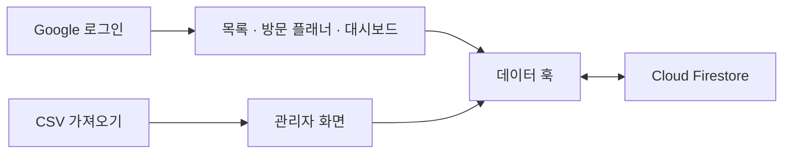

# NCDST · 가맹점 방문 영업 관리
> 가맹점 정보, 방문 일정, 컨택 결과와 설치 진행 상태를 함께 관리하는 React 웹 애플리케이션.

현장 영업의 **대상 가맹점 확인 → 방문 계획 → 결과 기록 → 진행 현황 분석** 흐름을 화면과 데이터 모델로 구현한 프로젝트입니다. 앱의 화면 이름은 ‘NPay 영업 관리’입니다.

## 해결하려는 문제
영업 대상 목록과 개인 방문 계획, 후속 연락 이력이 나뉘어 있으면 담당자가 다음 행동을 결정하기 어렵습니다. 가맹점 정보를 중심으로 방문·설치·컨택 정보를 모으고, 담당자와 그룹별 현황을 확인하도록 구성했습니다.

## 주요 기능
- **가맹점 관리:** 커넥트·예약 유형, 담당자, 그룹, 방문 결과, 설치 상태와 컨택 이력 관리
- **방문 플래너:** 날짜별 방문 계획 및 순서 관리
- **대시보드:** 담당자·그룹·유형별 필터, 방문 결과·설치 진행·컨택 단계 통계
- **CSV:** 관리자 화면의 양식 다운로드·가져오기, 목록 내보내기
- **로그인·사용자 관리:** Google 로그인, 사용자 승인 상태 및 관리자 화면
- **데이터 동기화:** Firestore 실시간 구독 및 여러 탭을 지원하는 로컬 캐시

## 설계에서 볼 부분
### 공통 가맹점 데이터와 개인 방문 계획 분리
`Merchant`와 `UserPlan`을 분리합니다. 개인 계획에는 사용자·가맹점 ID, 예정일, 순서를 저장하고 화면에서 가맹점 정보와 합칩니다. 공통 정보와 개인별 일정의 역할을 나눈 구조입니다.

### 영업 단계의 데이터 모델링
`src/types.ts`에 방문 결과, 설치 상태, 컨택 분류를 정의합니다. 대시보드에서는 이 값을 기준으로 상태별 집계를 만듭니다.

### 외부 저장소와 화면 사이의 훅
`src/useMerchants.ts`에 사용자, 가맹점, 계획, 설정, 감사 로그 관련 조회·수정 로직을 모았습니다. 대량 쓰기는 500건 단위로 나누는 처리를 포함합니다.



## 기술 스택
React 19 · TypeScript · Vite 6 · Tailwind CSS 4 · Firebase Authentication · Cloud Firestore · Recharts · Papa Parse

## 로컬 실행
```bash
git clone https://github.com/NeverBeTail/ncdst.git
cd ncdst
npm ci
```

이 앱은 로그인과 Firestore 연결을 전제로 합니다. 별도 개발용 Firebase 프로젝트에서 다음 항목을 준비하세요.

1. `firebase-applet-config.json`을 개발용 프로젝트 설정으로 변경합니다. `firestoreDatabaseId`도 실제 데이터베이스와 맞춰야 합니다.
2. Firebase Authentication에서 Google 로그인을 설정하고 로컬 실행 도메인을 승인합니다.
3. [Firestore 규칙](firestore.rules)과 사용자 문서의 역할·승인 상태를 함께 확인합니다.
4. `src/useMerchants.ts`의 초기 관리자 판별 조건을 개발 환경에 맞게 검토합니다. 로그인 성공만으로 모든 기능 사용이 허용되지는 않습니다.

```bash
npm run dev
```

기본 개발 주소는 `http://localhost:3000`입니다. 기존 AI Studio 템플릿의 Gemini 키 안내만으로는 이 앱을 설정할 수 없습니다. 핵심 영업 관리 흐름에는 Firebase 설정이 필요합니다.

## 검증 명령
```bash
npm run lint
npm run build
npm run preview
```

`lint`는 TypeScript 타입 검사입니다. 현재 `package.json`에 자동 테스트 명령은 없습니다. 빌드 검사와 실제 Firebase 권한·데이터 동작 검증은 별도로 수행해야 합니다.

## 코드 읽기
| 파일 | 역할 |
| --- | --- |
| [App](src/App.tsx) | 가맹점 목록과 화면 흐름, CSV 내보내기 |
| [Planner](src/Planner.tsx) | 방문 계획 |
| [Dashboard](src/Dashboard.tsx) | 영업 현황 집계와 시각화 |
| [Admin](src/Admin.tsx) | 사용자·가맹점 관리와 CSV 가져오기 |
| [데이터 훅](src/useMerchants.ts) | Firestore 조회·변경·구독 |
| [타입](src/types.ts) | 가맹점·사용자·방문 계획 모델 |

## 현재 범위와 개선 과제
- 실시간 구독과 캐시 구현이 있으며, 오프라인 상태의 전체 업무 흐름을 검증했다는 의미는 아닙니다.
- 관리자 초기 설정과 데이터 접근 규칙은 실행 환경에 맞는 검토가 필요합니다.
- `DRAFT_firestore.rules`와 운영 규칙을 구분하고, 규칙 변경에는 권한 테스트가 필요합니다.
- 별도 샘플 데이터 기반 체험 모드와 핵심 업무 흐름의 자동 테스트를 추가하면 프로젝트를 더 쉽게 평가할 수 있습니다.

[개발자 GitHub](https://github.com/NeverBeTail) · [브랜드 CRM 프로젝트](https://github.com/NeverBeTail/Brand-sales-crm)
